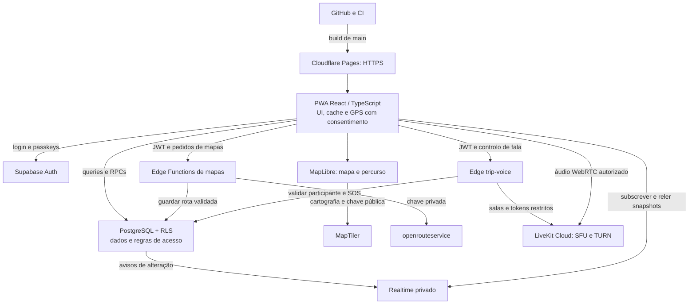
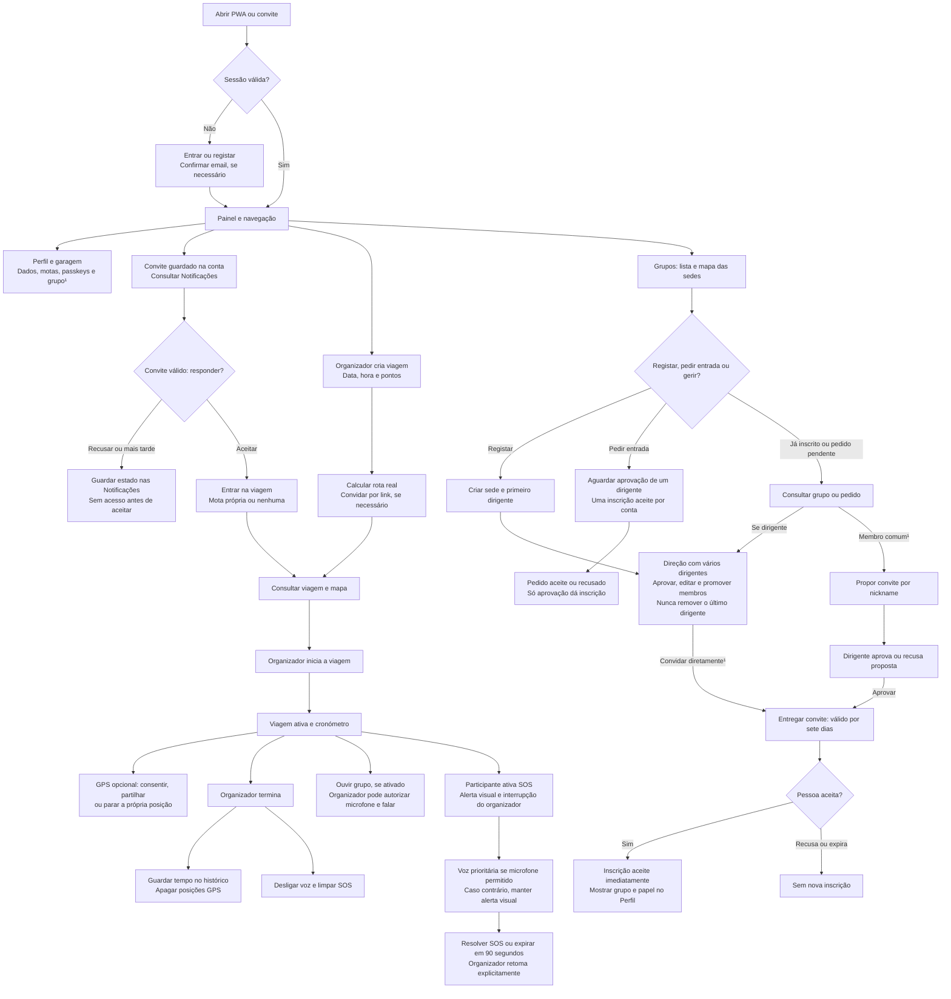

# RideSync — documentação da PoC

> Estado atualizado em 2026-10-24: migrations 001–009 aplicadas no Supabase.
> Grupos e voz/SOS têm backend ativo; `trip-voice` publicada e acesso real ao
> LiveKit validado por API. Grupos continuam opcionais: zero ou um por conta.
> O áudio entre telemóveis/headsets e o comportamento em redes móveis ainda
> requerem validação física. IA e uploads de fotos continuam por implementar.

> Em desenvolvimento local, sem publicação: migration 010, convites de grupo
> com revisão pela direção e grupo/candidatura no Perfil. [Estado e testes](docs/25-GROUP-INVITATIONS-AND-PROFILE.md).

## Objetivo
Validar que motards conseguem criar e partilhar uma viagem, escolher a mota, participar em grupos e ver as posições uns dos outros em tempo real **com a PWA aberta**. Um planeador com IA transforma pedidos em itinerários validados por um motor de rotas.

## Stack aprovada
React + TypeScript + Vite; Tailwind; TanStack Query; Zustand quando necessário; MapLibre GL JS + MapTiler (tiles/style) + openrouteservice (routing/geocoding); Supabase Free Tier (Auth, PostgreSQL, Realtime, Storage, Edge Functions); motor de routing openrouteservice com adapter substituível; LiveKit Cloud para áudio WebRTC autorizado; fornecedor LLM por decidir; Cloudflare Pages.

## Arquitetura da aplicação

A PWA é servida pela Cloudflare Pages. O Supabase autentica e autoriza os dados;
o MapTiler fornece cartografia e o openrouteservice calcula percursos reais.
Grupos/sedes e voz/SOS têm backend ativo. Grupos usam a mesma PWA,
PostgreSQL/RLS e cartografia; a voz usa a Edge Function `trip-voice` e LiveKit.
IA e uploads de fotos continuam planeados e não estão representados como
serviços disponíveis.

O áudio passa pela LiveKit, enquanto o Supabase decide quem pode falar. As
posições GPS pessoais só ficam acessíveis aos participantes autorizados; as
sedes dos grupos são dados explicitamente publicados para contas autenticadas.
O service worker guarda a aplicação estática, sem prometer GPS/voz em segundo
plano ou mapas offline. [Arquitetura detalhada](docs/03-TECHNICAL-ARCHITECTURE.md).

## Fluxos principais da aplicação

O diagrama reúne acesso, garagem/perfil, convites, viagens, GPS, voz/SOS e grupos.
Grupos e voz/SOS já dispõem do backend necessário; o áudio entre aparelhos
continua sujeito ao teste físico descrito no roteiro.
Entrar num grupo motard não concede acesso automático a viagens privadas.

¹ Convites de grupo e apresentação no Perfil dependem da migration 010 e da publicação, ainda pendentes. Aceitar um convite aprovado dá entrada direta; candidaturas espontâneas aguardam aprovação.

GPS e voz exigem internet e a PWA ativa; desligar GPS ou voz é uma decisão
individual. O SOS visual é independente da permissão de microfone, avisa apenas
o grupo ligado à viagem e não contacta o 112. [Fluxos e estados detalhados](docs/07-UX-FLOWS.md).

## Ordem de leitura
1. `CLAUDE.md` — instruções de execução
2. `docs/01-BUSINESS-PRD.md` — visão e regras de negócio
3. `docs/02-FUNCTIONAL-REQUIREMENTS.md` — requisitos e aceitação
4. `docs/03-TECHNICAL-ARCHITECTURE.md` — arquitetura e fluxos
5. `docs/04-DATA-MODEL-AND-SECURITY.md` — esquema, RLS e privacidade
6. `docs/05-API-AND-REALTIME.md` — contratos
7. `docs/06-AI-DESIGN.md` — integração de IA
8. `docs/07-UX-FLOWS.md` — ecrãs e UX
9. `docs/08-DELIVERY-PLAN.md` — fases e tarefas
10. `docs/09-TEST-AND-ACCEPTANCE.md` — testes e definição de pronto
11. `docs/10-DECISIONS-AND-RISKS.md` — ADRs e pendências
12. `docs/11-OPERATIONS.md` — setup, deploy e observabilidade
13. `docs/12-MAPS-AND-NAVIGATION.md` — decisão e integração de mapas
14. [Desenvolvimento](docs/13-DEVELOPMENT.md)
15. [Publicação Cloudflare Pages](docs/14-CLOUDFLARE-PAGES.md)
16. [Convites e notificações](docs/15-INVITATIONS-AND-PARTICIPATION.md)
17. [Sessões e tracking](docs/16-TRIP-TRACKING.md)
18. [Interface](docs/17-UI-REDESIGN.md)
19. [Instalação e passkeys](docs/18-INSTALLATION-AND-PASSKEYS.md)
20. [Grupos motards](docs/19-MOTARD-GROUPS.md)
21. [Voz e SOS](docs/20-VOICE-AND-SOS.md)
22. [Revisão documental](docs/21-DOCUMENTATION-REVIEW.md)
23. [Histórico do pull request e integração](docs/22-PULL-REQUEST.md)
24. [Estado real e roteiro de teste de grupos e voz](docs/23-FEATURE-TEST-GUIDE.md)
25. [Ativação remota de grupos e voz](docs/24-GROUPS-VOICE-ACTIVATION.md)

26. [Convites de grupo e grupo no Perfil — implementação local](docs/25-GROUP-INVITATIONS-AND-PROFILE.md)

## Limites explícitos
Não prometer GPS ou voz com ecrã bloqueado/segundo plano no iOS. SOS avisa apenas o grupo da viagem, não é contacto com emergência/112. Diretório de grupos e sedes é visível a utilizadores autenticados; dados legais são autodeclarados. Chat, pagamentos, navegação turn-by-turn, monetização e app nativa continuam fora do âmbito. GPS e microfone exigem consentimentos independentes.

## Desenvolvimento

Consultar [docs/13-DEVELOPMENT.md](docs/13-DEVELOPMENT.md) para instalação, `.env`, migrations e testes.

## Abrir a PWA

Publicação HTTPS e instalação em iPhone/Android: [Cloudflare Pages](docs/14-CLOUDFLARE-PAGES.md).
O push para o GitHub não publica automaticamente o site antes de ligar a integração.

## Como começar
Abrir este repositório no Claude Code e enviar o conteúdo de `PROMPT-CLAUDE.md`. O Claude deve primeiro inspecionar o repositório, elaborar um plano, assinalar decisões bloqueantes e implementar faseadamente.

## Decisão de mapas e navegação (ADR-007)
- **Mapa interno:** MapLibre GL JS, com estilos/tiles MapTiler.
- **Cálculo de rotas e geocoding:** openrouteservice; a rota renderizada tem origem no serviço de routing, não no LLM.
- **Navegação opcional:** abrir Google Maps ou Waze através de URLs oficiais, sem integrar SDK de navegação nem prometer preservar waypoints.
- **Plataformas:** mesma PWA em Safari iOS e Chrome Android; validar instalação, safe areas e GPS foreground em dispositivos reais.
- Ao abrir uma app externa, a PWA pode ser suspensa e **o tracking pode parar**. Apresentar última localização + timestamp e não anunciar tracking em background.
- Confirmar licenças, planos gratuitos, quotas, atribuições e termos de cada fornecedor antes de usar credenciais reais. Consultar `docs/12-MAPS-AND-NAVIGATION.md`.

## Grupos motards e voz/SOS

[Como testar e o que falta ativar](docs/23-FEATURE-TEST-GUIDE.md).

- [Grupos e direção partilhada](docs/19-MOTARD-GROUPS.md): diretório, mapa de
  sedes, pertença opcional (zero ou um grupo por conta), criação por qualquer
  conta elegível, aprovação de entradas e vários dirigentes.
- [Voz da viagem e SOS](docs/20-VOICE-AND-SOS.md): áudio do organizador, prioridade
  de SOS, LiveKit Cloud, configuração, limites e validação de áudio em dispositivos reais pendente.
- [Revisão documental](docs/21-DOCUMENTATION-REVIEW.md): inconsistências corrigidas
  e distinção entre implementado, publicado e ainda não validado em hardware.

## Manutenção obrigatória

Em cada alteração, rever toda a documentação e atualizar o README e os documentos
afetados na mesma entrega. Manter coerentes requisitos, decisões, arquitetura,
contratos, segurança, UX, plano, testes e operação. Identificar o que está apenas
implementado localmente, o que foi aplicado/publicado e o que foi efetivamente
validado, incluindo limitações e próximos passos. Após migrations ou deploy,
atualizar o estado só depois de verificar a execução. Preservar recibos históricos
e validar links e IDs ao alterar a documentação. Regra permanente do utilizador,
registada também em CLAUDE.md.
